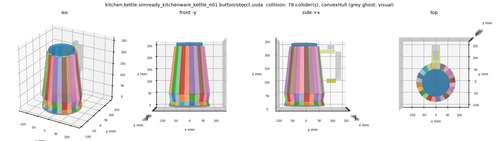
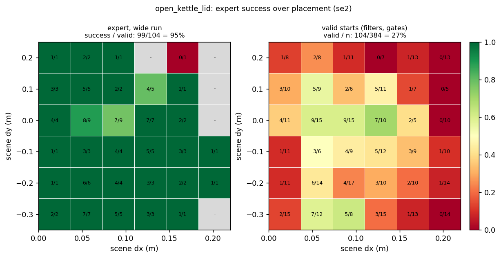

# 验证报告：open_kettle_lid

commit 1c8e1a368cca2d9b81193eff75471d22582ca61c · 机器 /home/zhaobo/a2r-stages/machine.yaml · 物理 d7 · 2026-11-25 · 输出 `/home/zhaobo/e10-kettle-lid-t12-20261124/validate/1c8e1a36`

## 验收线

| 项 | 结果 | 分母 | 比例 | 线 | 判定 |
|---|---|---|---|---|---|
| 资产可移植 | 绝对引用 0，打不开 0 | 17 个 USD 层 | - | 都为 0 | **pass** |
| 碰撞与视觉一致 | object.usda 74/78 个碰撞体 p95 > 5 mm（最差 12.1 mm，a2r_proxy_074），截面图 `/home/zhaobo/e10-kettle-lid-t12-20261124/validate/1c8e1a36/preflight/collision_visual_0.png` | 2 个资产 | - | 每个碰撞体 p95 <= 5 mm（3 mm 起提示） | **review** |
| 全状态占地 | 全部通过 | 1 个状态 | - | 离底座 >= 0.15 m 且在 +X 半平面 | **pass** |
| 名义位置关键帧链可达 | 32/32 | 摆出的起点 | 100.0 % | 报告（推不通先不跑物理） | **pass** |
| 名义位置专家 | 64/64 | 有效起点 | 100.0 % | >= 0.90 | **pass** |
| 宽范围专家（有效起点） | 99/104 | 有效起点 | 95.2 % | >= 0.90 | **pass** |
| 宽范围提议有效率（过滤接受率） | 104/384 | 全部提案 | 27.1 % | min_valid_fraction 0.10（低于则 review） | **pass** |
| 宽范围 IK 可达率（只报告） | 175/384 | 全部提案 | 45.6 % | - | **pass** |
| Home 专家（T12） | 提案 192 → 物理有效 165 → 可行 37 → 成功 37，p95=579 steps, failed=0, timeout=0 | 物理有效且通过规格关键帧可行性过滤的 Home | 100.0 % | 成功率 ≥ 90%，未完成 ≤ 5%，成功步数 p95 ≤ 30 s | **pass** |
| 建库冒烟（每组 40） | 缺 无 | 声明的接触前类型 | - | 每个声明的类型都能截到 | **pass** |
| 穿模筛查（专家 / 随机，只报告） | 没有可测的物体对（只测刚体两两之间，铰接件不测） | 0 个物体对，每个策略的首回合 | - | 专家最深 <= 1 mm，没有回合超过警告深度；超出只提示 | **pass** |
| 随机策略基线（只报告） | 专家 58/64，随机 0/64 | 冒烟库起点的首回合 | 0.0 % | 随机动作：到 p25 为止的起点类型成功 0 个，之后的类型 <= 10%（准入 A9 的数）；超出只提示 | **pass** |
| 初始化视频 | 1 段，/home/zhaobo/e10-kettle-lid-t12-20261124/validate/1c8e1a36/videos | - | - | 能生成，内容由用户判断 | **pass** |
| 完整视频 | 8 段，有效起点 3/8，成功 3，/home/zhaobo/e10-kettle-lid-t12-20261124/validate/1c8e1a36/videos | - | - | 能生成，每个实例有有效起点；内容由用户判断 | **pass** |

总判定：**review**（pass = 全部通过；review = 需要用户决定的项；fail = 未达线）

## 各步

| 步 | 任务 | env × seed | 结果 | 墙钟 s |
|---|---|---|---|---|
| preflight | `spec:dev/open_kettle_lid` | 32 × 1 | 资产可移植 pass, 碰撞与视觉一致 review, 全状态占地 pass | 20.003 |
| keyframe_check | `spec:dev/open_kettle_lid` | 32 × 1 | chain 32/32 | 10.002 |
| nominal | `spec:dev/open_kettle_lid` | 64 × 1 | 64/64 valid (64 proposals) | 30.003 |
| wide | `spec:kitchen/open_kettle_lid` | 128 × 1,2,3 | 99/104 valid, 104/384 proposals | 300.033 |
| home | `spec:kitchen/open_kettle_lid` | 64 × [100003, 100004, 100005] | 提案 192 → 物理有效 165 → 可行 37 → 成功 37，p95=579 steps, failed=0, timeout=0 | 100.010 |
| heldout | `spec:kitchen/open_kettle_lid` | 0 × - | no held-out instances (seed-only held-out: say so in the report) | - |
| bank_smoke | `spec:kitchen/open_kettle_lid` | 64 × 11 | 40 entries, missing none | 90.009 |
| penetration | `spec:kitchen/open_kettle_lid` | 64 × 1 | 专家 58/64，随机 0/64；0 个物体对 | 130.013 |
| videos | `spec:kitchen/open_kettle_lid` | 8 × 1 | 初始化 1 段, 完整 8 段 | - |

## Home 摆位与终止

物理有效中的可行比例 22.4 %。

| 项目 | 原因 | 数量 |
|---|---|---|
| 物理拒绝 | 未落定 | 0 |
| 物理拒绝 | 落定后越界 | 27 |
| 规划拒绝 | ik | 128 |

## 资产：碰撞体叠加在可视网格上

每个资产四个视角，彩色半透明是碰撞体（每个碰撞体一种颜色），灰色虚影是可视网格；加载时才烘焙的凸分解不在 USD 里，画不出来。超线的资产另有截面图（见验收线一行）。只报告，不改判定。

| 资产 | 判定 | 碰撞体（量过 / 照画） | 叠加图 |
|---|---|---|---|
| `kitchen.kettle.simready_kitchenware_kettle_n01.button/object.usda` | fail | 78 / 0 |  |
| `kitchen.table.procedural_worktop.std/object.usda` | pass | 1 / 0 |  |

## 关节余量（T8，只报告）

名义位置 32 个推通的起点上，3 个关键帧里有 **0** 个离关节限位的最小余量低于 0.3 rad（docs/new-task.md T8 的数）。`keyframe_check` 仍按 `--margin 0` 判，这一节不改判定。

| 关键帧 | 最小余量 rad | 在第几个关节 | 各关节中位数里最小的 rad |
|---|---|---|---|
| k_pre | 0.345 | J4 | 0.345 |
| k_press | 0.497 | J4 | 0.497 |
| k_back | 0.345 | J4 | 0.345 |

## 穿模筛查与随机策略基线（只报告）

对建库冒烟的小库跑 `check --policies expert,random`（64 env，每个策略只算每个 env 的首回合），穿模监测量刚体物体两两之间的穿入深度（docs/spec-reference.md §14）。这一步只报告，不挡后面的步骤；墙钟 130.013 s。

没有可测的物体对：监测只测刚体物体两两之间，两个都固定的对和铰接件不测。

| 起点类型 | expert 成功 / 回合 | random 成功 / 回合 |
|---|---|---|
| pregrasp | 58/64 | 0/64 |

## 宽范围放置覆盖（按 se2，384 个提案）

**x** 声明 [0.0, 0.22]，成功样本覆盖 [0.0010814255801960826, 0.1923661082983017]

| 区间 | 提案 | 有效 | 成功 | 有效率 | 有效成功率 |
|---|---|---|---|---|---|
| +0.000 .. +0.037 | 66 | 12 | 12 | 18.2 % | 100.0 % |
| +0.037 .. +0.073 | 64 | 32 | 31 | 50.0 % | 96.9 % |
| +0.073 .. +0.110 | 66 | 25 | 23 | 37.9 % | 92.0 % |
| +0.110 .. +0.147 | 65 | 23 | 22 | 35.4 % | 95.7 % |
| +0.147 .. +0.183 | 57 | 10 | 9 | 17.5 % | 90.0 % |
| +0.183 .. +0.220 | 66 | 2 | 2 | 3.0 % | 100.0 % |

**y** 声明 [-0.35, 0.25]，成功样本覆盖 [-0.3464494049549103, 0.18544094264507294]

| 区间 | 提案 | 有效 | 成功 | 有效率 | 有效成功率 |
|---|---|---|---|---|---|
| -0.350 .. -0.250 | 77 | 18 | 18 | 23.4 % | 100.0 % |
| -0.250 .. -0.150 | 76 | 17 | 17 | 22.4 % | 100.0 % |
| -0.150 .. -0.050 | 57 | 17 | 17 | 29.8 % | 100.0 % |
| -0.050 .. +0.050 | 66 | 31 | 28 | 47.0 % | 90.3 % |
| +0.050 .. +0.150 | 48 | 16 | 15 | 33.3 % | 93.8 % |
| +0.150 .. +0.250 | 60 | 5 | 4 | 8.3 % | 80.0 % |

**yaw_rad** 声明 [-3.1416, 3.1416]，成功样本覆盖 [-3.095236301422119, 3.1280603408813477]

| 区间 | 提案 | 有效 | 成功 | 有效率 | 有效成功率 |
|---|---|---|---|---|---|
| -3.142 .. -2.094 | 75 | 29 | 28 | 38.7 % | 96.6 % |
| -2.094 .. -1.047 | 49 | 4 | 3 | 8.2 % | 75.0 % |
| -1.047 .. +0.000 | 57 | 21 | 21 | 36.8 % | 100.0 % |
| +0.000 .. +1.047 | 56 | 20 | 19 | 35.7 % | 95.0 % |
| +1.047 .. +2.094 | 67 | 14 | 13 | 20.9 % | 92.9 % |
| +2.094 .. +3.142 | 80 | 16 | 15 | 20.0 % | 93.8 % |

## 放置热力图（按 se2 的 x × y）

左：有效起点里的成功率；右：提案里的有效率（过滤、门禁之后）。每格写分子/分母，灰格没有样本。网格在 `wide/placement_heatmap.json`，`python -m a2r.pipelines.policy_videos heatmap --expert open_kettle_lid=/home/zhaobo/e10-kettle-lid-t12-20261124/validate/1c8e1a36` 用同一组格子画策略的成功率。只报告，不改判定。

## 实测覆盖

99 个成功起点在交互点 `kettle.button` 的凸包占共享工作区（r 0.15–0.6 m、方位 ±90°）面积的 **19.1 %**（轮廓上界，不是密度），100 % 的成功点在共享工作区内；朝向跨度占整周的 **90 %**（对称件只需一个周期）。

被拒 280 个提案，卡得最多的位置：k_back 236、链外（工作区 / 门禁） 44。

## 声明的放置框（不是覆盖）

声明的放置框（底座坐标，x [0.3, 0.52]，y [-0.24999999999999997, 0.35]）占共享工作区（r 0.15–0.6 m、方位 ±90°）面积的 24.8 %，朝向宽度占 100 %；框中心在共享工作区内，框面积的 1 % 落在共享工作区外。

[wide 的失败现场与逐步动作](wide/failures/)

[bank_smoke 的失败现场与逐步动作](bank_smoke/failures/)

## 失败分型（`tasks expert-diagnose failures`，默认阈值）

按终止原语 × 终止时贴限的关节 × 物体相对手 × 末 60 步是否在动分组。改专家前先看这里：关节贴限的组先查可达和过滤口径，手和物体都不动的组先查是否卡住或顶限位，不要先调参数（docs/expert-playbook.md 排查套路 P4）。

**wide**：失败现场 5 个，分成 3 组。全表：[wide/diagnose/failures.md](wide/diagnose/failures.md)

| 结局 | 终止原语 | 关节 | 物体相对手 | 末段 | 数量 | 代表 (seed:env) |
|---|---|---|---|---|---|---|
| timeout | partapproach | J4上限 | 物体距TCP>100mm | 手和物体都不动 | 2 | 100003:82 |
| timeout | press | J4上限 | 物体距TCP>100mm | 手和物体都不动 | 2 | 200006:104 |
| timeout | press | J4上限 | 物体距TCP 30–100mm | 手和物体都不动 | 1 | 100003:40 |

## 宽范围失败分布

按阶段：`{"timeout:press": 3, "timeout:partapproach": 2}`

原语失败码：`{"none": 5}`

## 待决 / 未解决

- Home 可行数低于物理有效数的 25%，复查 64×64 次尝试下的可采轨迹数。
- 没有留出实例：留出集只能换 seed，不说明泛化（build-reset-bank.md §2）。

## 下一步

- 判定为 pass 或 review 时，把 `status_proposed.yaml` 的内容合入规格的 `status:` 块，并把本报告交给用户确认专家覆盖范围（docs/new-task.md 第 8 步）；正式起点库在确认之后才建（docs/build-reset-bank.md）。
- 正式起点库用哪个采样方案见 docs/build-reset-bank.md §0；建成后登记到 `configs/reset_banks/latest.yaml`（该题的现行起点库只记在那里，规格的 `status:` 块不填 `train_bank` / `test_bank` / `reset_scheme`）。本命令的建库冒烟仍是 v1 的分组冒烟，只说明各声明类型能截到。
- 判定为 fail 时按 docs/expert-playbook.md「排查套路」处理：先做前置检查 P1–P5（含上面的失败分型），分清问题在专家里还是在边界外，再改；改后用 `tasks expert-diagnose pair` 在同一批行上对照，修完重跑本命令。
